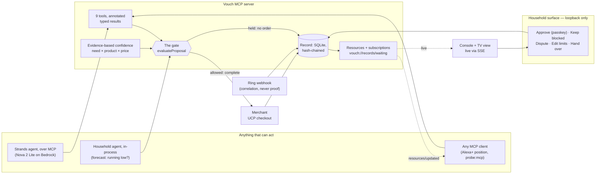
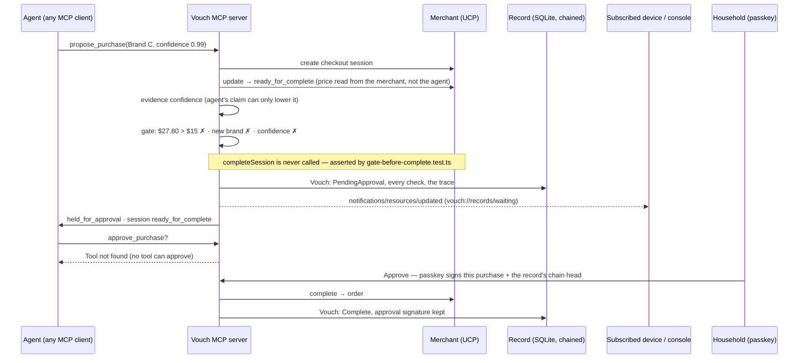

# Vouch

[](https://github.com/ogola5/vouch/actions/workflows/ci.yml)

**The trust layer for what your AI agent actually did — not just what it says it will do.**

Amazon Developer Hackathon 2026 ("Build, Ship, Shape") — primary track **Alexa+**, secondary
integrations **Ring** and **Fire TV**, AWS Builder mini-challenge for reasoning/explanation.

See [`vouch-project-brief.md`](./vouch-project-brief.md) for the full pitch, the competitive
positioning against KYA/ACP/UCP, and the guardrails on what never to claim. See
[`BUILD_PLAN.md`](./BUILD_PLAN.md) for the architecture, stack decisions, and week-by-week plan.

## How it works

**One rule shapes the whole design: the agent may do anything that cannot increase its own
authority.** So the agent's surface (MCP) can propose, explain and narrow, but never approve or
widen. Approving and widening live on a separate, loopback-only household surface that no model
can reach, behind the household's passkey.



**One held purchase, end to end.** The gate runs *on* the store's own checkout, between
`ready_for_complete` and `completed`, so a stop leaves real evidence behind: a checkout one call
short of an order.



**And when it gets it wrong:** "I didn't want that" → `record_dispute` → the item drops from Auto
to Ask, and the confidence bar tightens by 0.03. Good behaviour later loosens it back toward the
household's own number, and never past it. The console then re-runs the same gate on the same
purchase to show *"today it would be held"*.

| Where to look | What it proves |
|---|---|
| [`packages/shared/src/gate.ts`](packages/shared/src/gate.ts) | The gate: every check it runs, passes included |
| [`packages/mcp-server/src/service.ts`](packages/mcp-server/src/service.ts) | The gate on the UCP transition; failures, declines, approvals and the re-check |
| [`packages/mcp-server/src/tools.ts`](packages/mcp-server/src/tools.ts) · [`resources.ts`](packages/mcp-server/src/resources.ts) | The MCP surface: annotations, typed results, resources and subscriptions |
| [`packages/mcp-server/test/gate-before-complete.test.ts`](packages/mcp-server/test/gate-before-complete.test.ts) | An out-of-bounds proposal never reaches `completeSession` |
| [`packages/mcp-server/test/security-matrix.test.ts`](packages/mcp-server/test/security-matrix.test.ts) | 20 attacks over MCP, each blocked |
| [`packages/eval/`](packages/eval/) | The simulations and the published numbers, pinned by `claims.test.ts` |

## A note on UCP, since the submission will be read by Amazon engineers

UCP (Universal Commerce Protocol) is an **open standard**, not an Amazon specification. It was
founded by Google, Shopify, Etsy, Target and Wayfair; Amazon, Meta, Microsoft, Salesforce and
Stripe joined the UCP Tech Council in April 2026. Vouch is not "a reference implementation of
Amazon's spec" — it is a household trust layer built on the open standard Amazon has just
committed to. [`packages/shared/src/ucp.ts`](./packages/shared/src/ucp.ts) is written against
the published [REST binding](https://ucp.dev/specification/checkout-rest/), snapshot `2026-04-08`.

Worth knowing for the architecture: UCP also defines an **MCP binding** with spec-fixed tool
names (`search_catalog`, `create_cart`, `create_checkout`, `complete_checkout`, `get_order`),
advertised through `/.well-known/ucp`. Those are the *merchant's* tools. Vouch's own MCP tools
(`create_mandate`, `propose_purchase`, …) are a distinct layer sitting in front of them — which
is the clearest statement of what this project actually is.

## What's real vs. simulated (keep this current — required for the submission writeup)

| Piece | Status |
|---|---|
| Mandate model + gate logic (`packages/shared`) | Real, with tests covering fail-closed behaviour and the dispute → threshold → changed-outcome loop |
| MCP server (mandate gate as an actual request-path check) | Real, over Streamable HTTP. The gate runs on the `ready_for_complete → completed` transition; a held purchase leaves a genuine UCP session parked one call short of an order |
| Trust history per item | **Real.** The household agent records every change in how far an item is handed over: set up, earned (an accepted offer), lost (a dispute), expired, or changed by you. Each card draws it as a line across Auto / Ask / Remind, with purchases and disputes marked. A test checks the history always ends at the mandate's actual mode |
| "What your no changed" | **Real.** For each disputed purchase, the console re-runs the *same* gate (`evaluateProposal`) on the *same* purchase against today's mandate: same price, brand, quantity and confidence. For example: "Then it bought on its own. Today, the exact same purchase would be held — it now asks you first." There is no checkout and no record. A test checks that the re-check agrees with what a real second attempt does. Records from before 2026-10-14 didn't keep the brand and quantity, so they are not re-checked rather than guessed |
| MCP beyond tools | **Real.** All 9 tools carry annotations: only `propose_purchase` is destructive and open-world, the one a client should confirm with a person. Six declare an `outputSchema` and return typed `structuredContent`. The record is also exposed as MCP **resources** (`vouch://records/waiting`, `vouch://records/{id}`, `vouch://mandates/{id}`). A client subscribed to "waiting" is **told when the gate holds a purchase, without asking** — the moment an Alexa+ device would say "a purchase needs your OK". The console uses the same subscription to update itself live |
| AP2 alignment | **Real export, not an AP2 integration.** Every mandate can be read as an **AP2 Intent Mandate**, using AP2's six fields as defined in its SDK (`models/mandate.py`, checked 2026-10-14). What AP2's Intent Mandate has no field for — a price ceiling as a number, and the confidence threshold that a dispute moves — is kept beside it, along with a note on how each field was filled. It is an MCP resource (`vouch://ap2/intent-mandates/{id}`) and appears on the console's Rules view. Nothing is signed or sent to an AP2 network |
| Pluggable into any MCP client (the Alexa+ position) | **Real.** `npm run probe:mcp` connects to the running server knowing only the URL. It reads the server's own rules, finds no tool that can approve, complete a checkout or raise a limit, asks for the $27.80 Brand C while *claiming* 0.99 confidence, and is still held (the evidence decides, not the claim). Its call to `approve_purchase` fails with "Tool not found". It leaves one held, never-completed checkout under its own mandate, `m_probe`. A test runs it against a real server |
| Separation of agent authority from household authority | Real and structural. The agent's MCP tools contain nothing that can widen its own authority — no `approve_purchase`, no mandate editing, no direct checkout. Those live on a separate `/household` surface a model never sees |
| Security matrix | A test, not a slogan: `packages/mcp-server/test/security-matrix.test.ts` runs 20 attacks against the real stack over MCP — from an agent approving its own purchase or naming its own price, to a store outage, an unsigned attempt to raise a limit, and an edit made straight in the database — records what actually happened to each, and fails unless every one is blocked. Currently **20/20 blocked**. It does not cover an attacker holding both the database and the household's passkey private key |
| Failure switches in the console | Simulations, labelled so: the store going down (the merchant answers 503; purchases fail closed as Failed records while the record stays readable), the model going down (the chat says so; the gate, record and household agent carry on), and the doorbell reporting corroborated or unconfirmed for the next orders (mock Ring only — refused when `RING_MODE=real`) |
| Every attempt leaves a record | Real: an attempt that fails before an order exists (store down, unknown product, the order step erroring) is written as a **Failed** Vouch naming the stage and the error, with the price left unknown rather than $0. A failure *after* the order exists (e.g. the doorbell provider erroring) never erases the order — it is recorded as Complete with the doorbell "unconfirmed". A held purchase can be **kept blocked**: the parked UCP checkout is cancelled and the household's no is recorded, with no passkey needed |
| Tamper-evident record | Real: every write of a Vouch appends a hash-chained snapshot (`packages/db` ledger), so editing an entry, deleting one, or editing the table the console reads is detected and named. Every passkey approval also **signs the chain's latest entry**, so even a careful, internally consistent rewrite of the whole ledger is caught by the household's signature. **Limits:** history written *after* the last passkey approval could be rewritten consistently by someone with database access; mandates and disputes are not chained, only Vouches; a database from before the ledger existed is chained from that moment on, which proves nothing about what came before. The console's "Simulate someone editing an old record" is a labelled demo control |
| Household approvals (passkeys) | Real WebAuthn, verified with `node:crypto` (no dependency). Anything that spends money or widens the agent's authority — approving a held purchase, raising a limit, handing an item over to Auto — needs the household's passkey (fingerprint, face or PIN); narrowing never does. The signed challenge names the exact action, and the signature is kept on the Vouch so it can be re-verified later. **Trust on first use:** until a passkey is registered, the local surface is trusted as before. One passkey per household; no multi-device or multi-member support. Attestation is "none". Must be opened at `localhost`, not `127.0.0.1` — browsers refuse passkeys on an IP address. Tested with a software authenticator; real-device use depends on the browser |
| Orchestrator ("the Alexa+ agent"), model-side | Real Strands agent on **Amazon Bedrock (Nova 2 Lite)**, driving the real tools; falls back to Gemini if no Bedrock key is set. Measured, not asserted: sending an out-of-bounds request through the gate rather than refusing in chat went from 5/8 to 16/16 trials after a prompt fix (`packages/orchestrator/test/gate-discipline.test.ts`), on one sentence and one model. Also measured (`conversation.test.ts`, 5 trials each): "I didn't want that" disputes the right purchase 5/5; a standing instruction becomes a faithful mandate *without* buying anything 5/5 (was 0/5 — it bought unasked and dropped the fallback brand); with the store down it says so and claims no success 3/3 |
| Study mode (tour + questions for real people) | Real questionnaire, stored only in the local SQLite file under a generated code, with consent required and every answer checked on the server. The summary shows medians and counts only. "Named a real reason" is a keyword hint that still needs a person to read the answer. **No study results exist until real sessions are run**; none are claimed |
| Persistence (`packages/db`) | Real SQLite via Node 24's built-in `node:sqlite` — mandates, vouches and disputes; a tightened threshold survives a restart |
| Household forecast (`packages/household`) | Real statistics: a per-item pace learned from refills, days left with an 80% range, a buy decision at a 1-in-5 chance of running out before delivery. Measured against calendar restocking and against a price-trigger baseline modelled on Auto Buy, on **synthetic** households (`packages/eval`). The deal pattern is assumed, so the Auto Buy result is published as a curve. The console's "Why not just Auto Buy?" panel replays one simulated household, computed live by the same code. Never claimed for real homes. No sensors — it learns from purchases and what the household tells it |
| Autonomous restocking, per item | Real: each item is **Remind**, **Ask** (the default) or **Auto** (optionally until a date, optionally within delivery days). Auto buys through the **same gate** as chat; Ask and Remind notify instead. The gate itself enforces the mode for anything the agent starts on its own (`autonomy_not_granted` / `autonomy_expired`), and trust moves: four accepted suggestions → an offer to take over for 90 days; a dispute → back to Ask. The demo household's history is **authored**, and its clock is a demo control that can fast-forward. Notifications appear in the console only — no phone push |
| Confidence the gate compares | Real and evidence-based: need × usual product × price against history, recorded on every Vouch. The agent's own claim can only lower it. The factor values are stated assumptions (`packages/household/src/confidence.ts`) |
| Mock UCP merchant (`/checkout-sessions` lifecycle, `.well-known/ucp`) | Real spec-conformant shape — derived status, `Idempotency-Key`, `UCP-Agent` enforcement — with simulated checkout/payment. No payment is processed and no goods exist; completing a session mints an order id |
| Ring webhook correlation | **Receiver real, deliveries simulated.** HMAC-SHA256 verification over the raw body, event parsing, classification (human/animal/vehicle) and time-window correlation are all real and tested, and run with `RING_MODE=real`. What has *not* happened is a delivery from Ring's servers: that needs partner account linking, which requires a sign-in and user-identity system this product deliberately does not have (`BUILD_PLAN.md` §7). `MockRingProvider` remains the default. Note that even a real webhook gives correlation against an expected window, never proof — Ring publishes no package-delivered event |
| Explanation when someone asks "why?" (`explain_vouch`) | **Real model, checked:** when a Bedrock key is set, `BedrockReasoningProvider` asks Nova 2 Lite to write it from the record's facts. The text is then checked against the record: every number must be in it, it must name the price and what stopped the purchase, and it must not claim a delivery or a purchase that didn't happen. Anything that fails, and any model error, falls back to fixed wording, and the console labels which one you're reading. **Live verification pending:** on 2026-10-14 the AWS account answered "Access to Bedrock models is not allowed for this account", so the live measurement has not run yet |
| Explanations inside a purchase result, and every confidence-threshold change | Deterministic on purpose (`RuleBasedReasoningProvider`): the number that moves the agent's authority must be reproducible, and a purchase must never wait on a model or depend on one being up |
| Alexa+ | Simulated via a web chat app (per track guidance — no real Alexa+ production access needed). You can **speak** to it and hear it answer, using the browser's own speech recognition and speech synthesis. There is no added dependency, but in Chrome and Edge the *browser* sends recognition audio to its maker's cloud, and the console says so. Spoken replies are trimmed for listening: no record ids, a couple of sentences |
| Alexa+ as a *real add-on* (MCP Toolkit) | **Blocked, not skipped.** The Alexa AI CLI sits behind a private AWS CodeArtifact registry gated on Solutions Architect onboarding, and Alexa+ has no African marketplace. Attempted and recorded in `BUILD_PLAN.md` §7; the track explicitly permits simulating via a web app |
| TV view (Fire TV track) | **A TV-layout web page, not a native Fire TV app**, and it says so on screen. The console's TV view shows, in large type: what's waiting for you, what's running low, what it did lately, and how far each item is handed over. It is drawn from the same state as Home. Arrow keys move between tiles (a remote's D-pad sends the same keys), Enter opens one, and Esc goes home. *(This row once claimed a React Native app; that was never true, corrected 2026-09-28.)* |

## Repo layout

```
packages/
  shared/             Mandate, Vouch, UCP types + the mandate gate (evaluateProposal) — done
  reasoning/          ReasoningProvider interface, RuleBasedReasoningProvider, BedrockReasoningProvider (explanations, checked)
  ring-integration/   PhysicalEvidenceProvider interface + MockRingProvider stub — done
  db/                 SQLite persistence for mandates/vouches/disputes — done
  mock-merchant/      UCP session lifecycle + /.well-known/ucp + demo price control — done
  mcp-server/         MCP server; the one place allowed to gate a purchase — done
  web-app/            Console: dashboard + demo controls over an MCP client — done
                      (the Strands chat orchestrator slots in beside the bridge, still to come)
  fire-tv-app/        React Native household surface — week 5

test/
  adaptive-loop.test.ts            the dispute/threshold/gate loop as pure logic
  adaptive-loop-persisted.test.ts  the same loop through the real gate, session and database
packages/shared/test/       gate.test.ts — the fail-closed mandate gate suite
packages/db/test/           store.test.ts — persistence, and the dispute transaction
packages/mock-merchant/test/ lifecycle.test.ts — UCP status machine, over HTTP
packages/mcp-server/test/   gate-before-complete.test.ts — the gate is never bypassed
                            end-to-end.test.ts — the demo script across two network hops
```

## Running it

Three services. One terminal each, or `npm run dev:all` to start all three at once:

```bash
npm install
npm run dev:mock-merchant   # UCP merchant       :4010
npm run dev:mcp-server      # Vouch MCP server   :4020/mcp
npm run dev:web-app         # Console (open this) :4030
```

Then open **http://127.0.0.1:4030** and walk the demo script:

1. **The world** — drop Brand A to `12.49`.
2. **Mandates** — create the detergent mandate (one button). Watch the confidence threshold.
3. **Propose a purchase** — Brand A at confidence `0.92` → it buys, and a Vouch appears.
4. Propose **Brand C** ($27.80) → **held**, with `price > max_price` shown as the rule that
   stopped it, and no order id. The checkout session really reached `ready_for_complete` and
   stopped there.
5. On the completed Vouch, click **"I didn't want that"** → the threshold moves 0.85 → 0.92.
6. Propose Brand A again at confidence `0.88` → now **held**, on `below_confidence_threshold`.
   Same purchase, same price. The agent's authority changed, not the product.

The console calls the same MCP tools an agent calls — it has no logic of its own, so what it
shows is what an agent would see.

## Checks

**Requires Node 24+.** Tests are plain `.ts` files executed directly by `node --test` using
Node 24's native type stripping, so there is no test framework, bundler or transpile step —
which is why there is no vitest/jest dependency here.

```bash
npm run typecheck   # tsc -b across the package graph, then the test sources
npm test            # 71 tests
```

Two things that follow from running TypeScript directly, both of which cost time to rediscover:

- **Type stripping executes types without checking them**, so `npm test` passing does not imply
  the code typechecks. Run both.
- **Stripping is strip-only — it erases annotations but does not transform syntax.** So
  constructor parameter properties (`constructor(private readonly x: T)`) are a runtime
  `SyntaxError`, and relative imports are written with a `.ts` extension
  (`rewriteRelativeImportExtensions` turns them into `.js` on emit). `npm test` runs `tsc -b`
  first, because tests import workspace packages by name rather than reaching into another
  package's `src/`.
